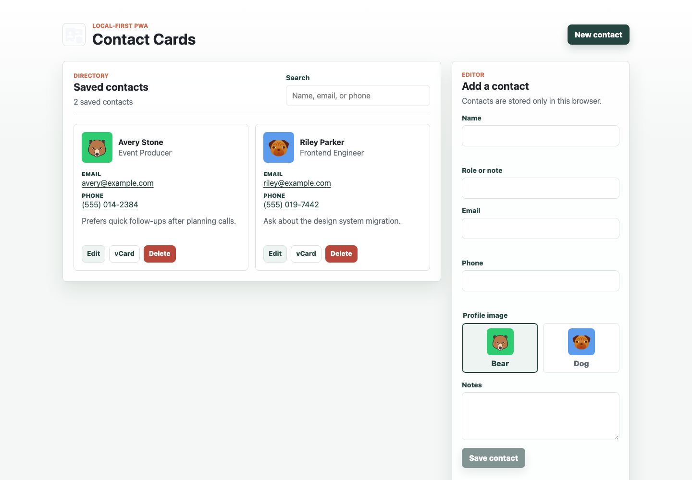

# Contact Card PWA

A polished, local-first contact card manager built with Vite and vanilla JavaScript. It runs as a static Progressive Web App, stores contacts in the browser, and is ready to deploy on Vercel.

## Live Demo

[https://contact-card-pwa.vercel.app](https://contact-card-pwa.vercel.app)

## Screenshot



## Features

- Create, edit, delete, search, and sort contact cards (by name or date added).
- Export any contact as a standard `.vcf` vCard, and bulk-import contacts from one or more `.vcf` files.
- Choose an avatar per contact — bear, dog, or auto-generated color initials.
- Local browser persistence via `localStorage` — no backend, account, or network request required.
- Client-side validation for name, email, and phone fields with inline error messaging.
- Automatic light/dark theme based on system preference.
- Fully keyboard-accessible: labeled controls, focus management on edit/cancel, `Esc` to cancel an edit, live-region status updates for screen readers.
- Installable PWA with an offline-capable service worker and app manifest.
- Demo data (Avery Stone, Riley Parker, Jordan Lee) is entirely fictional and ships only as a starting point — clear it any time from the app.

## Tech Stack

- Vite
- Vanilla JavaScript (ES modules, no framework)
- CSS custom properties (light/dark theming)
- Web Storage API
- Service Worker API

## Getting Started

```bash
npm install
npm run dev
```

The dev server will print a local URL, usually `http://localhost:5173`.

## Scripts

```bash
npm run dev       # Start local development
npm run build     # Build static production files into dist/
npm run preview   # Preview the production build locally
npm run check     # Run the production build as a lightweight verification
```

## Deploying to Vercel

Import the GitHub repository into Vercel and use these settings:

- Framework preset: Vite
- Build command: `npm run build`
- Output directory: `dist`
- Install command: `npm install`

The old Heroku deployment has been retired; this project is now intended to be hosted as a static site.

## Project Structure

```
src/
  main.js             # App bootstrap, event wiring, rendering
  styles.css           # Design system (light/dark)
  modules/
    avatars.js         # Avatar catalog + initials-avatar helpers
    storage.js          # localStorage load/save/normalize
    vcard.js             # vCard (.vcf) build/export/import parsing
public/
  manifest.webmanifest
  sw.js               # Offline cache-first service worker
```

## Privacy

All contact data lives only in the browser's `localStorage` on the visitor's device. Nothing is sent to a server. The seeded sample contacts are fictional demo data for first-run exploration.

## Project Status

This is a portfolio-ready refactor of the original Contact Card MVP. It is intentionally local-only for this version: no server, database, authentication, or cloud sync.
